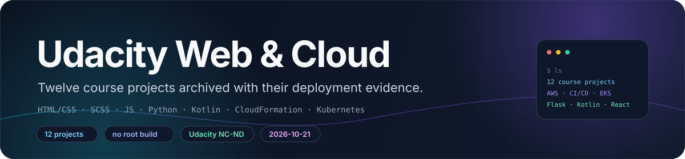
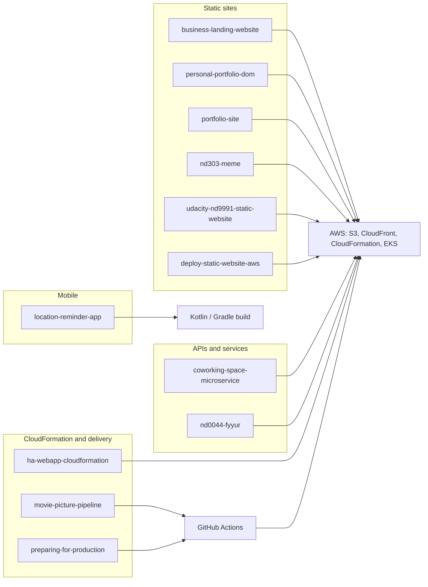

<div align="center">



# Udacity Web & Cloud Projects

**Twelve Udacity course projects — static sites, AWS deployments, CI/CD pipelines, Flask back ends and a Kotlin Android app — archived in one repository.**

S3 + CloudFront · CloudFormation · GitHub Actions → ECR → EKS · Flask + PostgreSQL · Kotlin / Android

[**简体中文**](README.zh-CN.md) · **English**

<a href="nd0044-fyyur/LICENSE.txt"></a>
<a href="docs/projects.md"></a>
<a href="ha-webapp-cloudformation/templates/servers.yml"></a>
<a href="nd0044-fyyur/README.md"></a>
<a href="location-reminder-app/build.gradle"></a>

</div>

> [!NOTE]
> **Current state.** An archive of twelve Udacity course projects, consolidated from separate
> repositories on 2026-10-21. Everything is coursework: no package is published, there is no root
> build or CI, and deployment credentials are not included.

## ✨ What's inside

- **Twelve self-contained projects.** Each top-level directory was a separate repository, imported
  with `git subtree` as the original README states, so project history travels with the code.
- **Every project keeps its own README.** Commands, rubric mapping and course instructions live
  there; this file is only the index.
- **Five AWS and CI/CD projects.** Two static-site deployments (S3 + CloudFront), a
  high-availability CloudFormation stack, and two Kubernetes services built and shipped from CI.
- **Three static front-end sites.** A Sass/BEM portfolio, a DOM-and-fetch portfolio exercise, and a
  two-page business landing site.
- **Flask appears in three projects.** Fyyur (SQLAlchemy + PostgreSQL + Flask-Migrate), the
  coworking analytics API, and the nd303 meme service.
- **One Kotlin Android app.** Location reminders with Room, Koin, Firebase Auth, Maps and
  geofencing; Gradle 8.4.1, Kotlin 1.9.23, `minSdk 24`.
- **One JavaScript app prepared for production.** Study Night with Parcel, Gulp, ESLint, Mocha and
  Cypress.
- **One Python multimedia pipeline.** nd303 quote ingestors (TXT/DOCX/CSV/PDF) and a Pillow meme
  renderer, exposed as both a CLI and a Flask route set.
- **Submission evidence is versioned with the code.** Console screenshots and AWS CLI JSON sit in
  each project's `screenshots/` and `submission/` directories.
- **No root build system.** No top-level `package.json`, `Makefile` or workflow; every project is
  run from its own directory.

## 🧠 Architecture

The twelve submissions are independent; there is no shared runtime. This map groups them by the part of the stack each one demonstrates, and every project keeps its own README with run instructions.



## 🗂️ Modules

| Project | Course / module | Stack | Entry point |
|---|---|---|---|
| [`portfolio-site/`](portfolio-site/README.md) | Portfolio Site project | HTML, SCSS, Sass CLI | `src/index.html`, `npm run build` |
| [`personal-portfolio-dom/`](personal-portfolio-dom/README.md) | Personal Portfolio (DOM + fetch) | HTML, CSS, vanilla JS | `index.html`, `js/scripts.js` |
| [`business-landing-website/`](business-landing-website/README.md) | Business landing page | HTML, CSS | `index.html`, `contact/contact.html` |
| [`deploy-static-website-aws/`](deploy-static-website-aws/README.md) | Deploy Static Website on AWS | S3, CloudFront, CloudFormation | `scripts/deploy.sh` |
| [`udacity-nd9991-static-website/`](udacity-nd9991-static-website/README.md) | nd9991 Cloud DevOps, Cloud Foundations project | S3, CloudFront, AWS CLI | `deploy.sh` |
| [`ha-webapp-cloudformation/`](ha-webapp-cloudformation/README.md) | High-availability web app with CloudFormation | VPC, ALB, Auto Scaling, EC2, S3, IAM | `scripts/deploy-all.sh` |
| [`location-reminder-app/`](location-reminder-app/README.md) | Android Kotlin Location Reminder | Kotlin, Gradle, Room, Koin, Firebase, Maps | `./gradlew assembleDebug` |
| [`preparing-for-production/`](preparing-for-production/README.md) | Study Night: Preparing for Production | JS, Parcel, Gulp, ESLint, Mocha, Cypress | `npm run gulp` |
| [`coworking-space-microservice/`](coworking-space-microservice/README.md) | cd12355 Coworking Space Service | Flask, PostgreSQL, Docker, CodeBuild, ECR, EKS | `scripts/deploy-codebuild.sh` |
| [`movie-picture-pipeline/`](movie-picture-pipeline/README.md) | CI/CD for a React + Flask app | React, Flask, Docker, Actions, ECR, EKS, Terraform | `.github/workflows/` |
| [`nd303-meme/`](nd303-meme/README.md) | nd303 Intermediate Python, Course 3 capstone | Python, Pillow, python-docx, pandas, Flask, Xpdf | `src/meme.py`, `src/app.py` |
| [`nd0044-fyyur/`](nd0044-fyyur/README.md) | nd0044 Backend Developer with Python, Course 2 | Flask, SQLAlchemy, PostgreSQL, Flask-Migrate | `app.py`, `flask db upgrade` |

There is no single component architecture to draw: these are twelve unrelated submissions, each
with its own topology. The deployment projects document theirs in their own READMEs and diagrams
(for example [`diagrams/architecture.mmd`](ha-webapp-cloudformation/diagrams/architecture.mmd) and
the four workflow files above), so this index deliberately has no architecture diagram.

Per-project detail — what runs, what is stubbed, where the evidence lives — is in
[`docs/projects.md`](docs/projects.md).

## ☁️ Cloud and CI/CD projects

| Project | What it provisions | Scripts | Evidence |
|---|---|---|---|
| `deploy-static-website-aws` | S3 website bucket, public-read bucket policy, CloudFront distribution, via `infra/cloudformation.yaml` | `scripts/deploy.sh`, `scripts/sync-site.sh` | `screenshots/`, `submission/evidence/*.json` |
| `udacity-nd9991-static-website` | Bucket, policy, static website hosting and CloudFront via AWS CLI calls | `deploy.sh`, `teardown.sh` | `submission/screenshots/`, `.deploy-state` |
| `ha-webapp-cloudformation` | VPC across two AZs, two public and two private subnets, two NAT gateways, ALB, Auto Scaling group of four `t3.medium` instances, private S3 bucket, IAM instance profile | `scripts/deploy-all.sh`, `scripts/destroy-all.sh` | `submission/evidence/`, `diagrams/` |
| `coworking-space-microservice` | Flask analytics API and PostgreSQL on EKS; CodeBuild to ECR | `scripts/deploy-codebuild.sh`, `scripts/deploy-k8s.sh`, `scripts/seed-db.sh` | `screenshots/`, `submission/evidence/` |
| `movie-picture-pipeline` | React and Flask services on EKS; four GitHub Actions workflows; Terraform cluster setup | `setup/terraform/`, `.github/workflows/` | `submission/screenshots/`, run logs |

The hostnames printed in these projects were captured during the Udacity review window and are not
kept alive. All three CloudFormation/CLI deployments require an AWS account with permission to
create buckets, policies, distributions and stacks.

## 🚀 Quick start

**Requirements:** there is no root entry point. Every project is self-contained and each has its
own README; run the commands from inside the project directory.

Static sites, where only the portfolio has a build step:

```sh
cd portfolio-site
npm install
npm run build                      # sass src/scss/main.scss dist/main.css

cd ../business-landing-website
python3 -m http.server 8000        # or simply open index.html
```

Fyyur (Flask + PostgreSQL), the only project with database migrations:

```sh
cd nd0044-fyyur
python3 -m venv .venv && . .venv/bin/activate
pip install -r requirements.txt
createdb fyyur                     # PostgreSQL must be running
flask db upgrade
python3 app.py                     # http://127.0.0.1:5000
```

The nd303 meme generator (needs the Xpdf `pdftotext` binary for PDF quotes):

```sh
cd nd303-meme
python3 -m venv .venv && . .venv/bin/activate
pip install -r requirements.txt
brew install xpdf                  # apt-get install xpdf on Debian/Ubuntu
cd src
python3 meme.py --body "Such wow" --author "Xander"
python3 app.py                     # http://127.0.0.1:5000
```

The Movie Picture applications, locally and without AWS:

```sh
cd movie-picture-pipeline/starter/backend
pipenv install && pipenv run serve  # http://localhost:5000/movies

cd ../frontend
nvm use && npm ci
REACT_APP_MOVIE_API_URL=http://localhost:5000 npm start
```

The Android app only builds with an Android SDK, a Firebase project and a Maps API key:

```sh
cd location-reminder-app
./gradlew testDebugUnitTest         # the same command the Android CI workflow runs
```

> [!TIP]
> Start from the project's own README rather than from this index: it carries the course brief,
> the rubric mapping where the course required one, and any setup such as Firebase or EKS.

## 🧪 Tests and CI

| Where | Command | What it covers |
|---|---|---|
| `movie-picture-pipeline/starter/backend` | `pipenv run test` | 3 pytest tests in `test_app.py` |
| `movie-picture-pipeline/starter/frontend` | `CI=true npm test` | 2 Jest suites, 3 tests (`App.test.js`, `MovieList.test.js`) |
| `location-reminder-app` | `./gradlew testDebugUnitTest` | 2 unit test classes in `app/src/test` |
| `location-reminder-app` | Android Studio runner | 4 instrumented test files in `app/src/androidTest` |
| `nd303-meme` | `python3 -m unittest discover tests` | one unittest file for the image pipeline |
| `preparing-for-production` | `npm run test`, `npm run cypress:run` | Mocha unit tests, 2 Cypress specs |
| `.github/workflows/` in `movie-picture-pipeline` | GitHub Actions | lint and test in parallel, then Docker build; CD pushes to ECR and deploys with `kustomize` |
| `.github/workflows/android.yml` | GitHub Actions | unit tests on Java 17 |

Only `movie-picture-pipeline` and `location-reminder-app` carry GitHub Actions checks that build or
test code. `nd0044-fyyur` and `coworking-space-microservice` also contain a `manual.yml`, but it is
Udacity's starter workflow that opens a Jira ticket for an incoming pull request and expects Jira
secrets; it does not build or test anything.

`location-reminder-app/README.md` asks for JDK 21 while its workflow pins Java 17, and the app
README's "Break Down Tests" section is still the starter template text.

## 📁 Repository layout

| Path | Contents |
|---|---|
| `docs/` | banner asset and the per-project reference in `docs/projects.md` |
| `<project>/` | one self-contained course project per directory, twelve in total |
| `<project>/README.md` | course brief, commands, rubric mapping and limitations |
| `<project>/screenshots/`, `<project>/submission/` | reviewer-facing screenshots and CLI/console evidence |
| `<project>/LICENSE*` | Udacity educational license in five projects |
| `movie-picture-pipeline/.github/workflows/` | four CI/CD workflows and `setup/terraform/` |
| `location-reminder-app/.github/workflows/android.yml` | Android unit-test workflow |

## 🧭 Scope and limits

This is a coursework archive, not production software. No release, versioning, SLA or support is
attached to it, and the code exists to satisfy Udacity project rubrics.

- **No root license.** The repository has no `LICENSE` or `NOTICE` at its root; five subprojects
  carry Udacity's educational license, the rest carry none.
- **Live infrastructure is not reproducible here.** The deployment scripts need AWS credentials and
  permissions; the EKS and Terraform path needs a cluster and eight GitHub secrets.
- **Evidence is time-bound.** Console screenshots and printed endpoints reflect the submission
  window; the LoadBalancer and CloudFront hostnames may no longer resolve.
- **Credential-gated app.** The Android project needs a Firebase configuration and a Maps API key
  that are not part of a working checkout.
- **Demo credentials in manifests.** The coworking Kubernetes Secret contains a placeholder
  database password in clear text and has to be replaced before reuse.
- **Not verified during this restyle.** No build, test, deployment or device run was executed, and
  the shallow clone does not include the per-project subtree history, so that claim is taken from
  the original README.

> [!WARNING]
> The deployment scripts create billable AWS resources. Destroy the stacks when you are done
> (`./scripts/destroy-all.sh`, `./teardown.sh`) and never commit real credentials; the CI workflows
> expect secrets, not checked-in keys.

## 🤝 Contributing

Issues and pull requests are welcome for documentation and reference fixes:

1. keep the per-project README as the source of truth and update it together with any command you
   change here;
2. do not add credentials, account identifiers, private URLs or generated build artifacts;
3. when reusing a project, keep its `LICENSE` file and the Udacity attribution intact.

If this archive is useful as a reference, a ⭐ helps.

## 📄 License and attribution

No license file is included at the repository root, so no license is asserted for the archive as a
whole. Licensing is per project:

- **Udacity educational license** — `coworking-space-microservice/LICENSE.txt`,
  `movie-picture-pipeline/LICENSE.md`, `nd0044-fyyur/LICENSE.txt`,
  `personal-portfolio-dom/LICENSE.txt` and `preparing-for-production/LICENSE.txt` carry Udacity's
  text (Copyright © 2012–2020, Udacity, Inc.), which grants use of the educational content under
  Creative Commons Attribution-NonCommercial-NoDerivs 4.0 and lists paid training, resale and
  institutional instruction as commercial use.
- **Declared differently in metadata** — `preparing-for-production/package.json` declares `MIT` for
  that package while the directory also ships the Udacity license text.
- **No license file** — `portfolio-site`, `business-landing-website`, `deploy-static-website-aws`,
  `ha-webapp-cloudformation`, `location-reminder-app`, `nd303-meme` and
  `udacity-nd9991-static-website` ship no license file. `nd303-meme/README.md` records that its
  starter code comes from `udacity/PYND` under the original Udacity Nanodegree license.
- **Third-party assets** — Bootstrap 4.3.1 (MIT) and Font Awesome Free 5.8.1 (CC BY 4.0, OFL 1.1,
  MIT) are vendored under `deploy-static-website-aws/vendor/` and
  `udacity-nd9991-static-website/website/vendor/`; their license texts are kept in those
  directories.

Udacity, Nanodegree and the course names are Udacity trademarks. This repository is an archive of
student work and is not affiliated with or endorsed by Udacity.

## ⭐ Star history

<div align="center">

<a href="https://star-history.com/#LeoLin990405/udacity-web-cloud-projects&Date">
  
</a>

</div>
