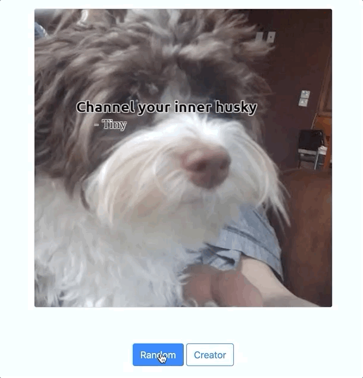

# Motivational Meme Generator

## Overview

A multimedia application that dynamically generates memes — images overlaid with
quotes — by ingesting quote files in multiple formats (TXT / DOCX / CSV / PDF),
manipulating images with Pillow, and exposing the pipeline through both a
command-line tool (`meme.py`) and a Flask web service (`app.py`).

This is the capstone project of Course 3 (Large Python Codebases with Libraries)
in Udacity's Intermediate Python Nanodegree (nd303).

## Demo



---

## Setup

### 1. Create and activate a virtual environment

```bash
python3 -m venv .venv
source .venv/bin/activate         # macOS / Linux
# .venv\Scripts\activate.bat       # Windows cmd
```

### 2. Install Python dependencies

```bash
pip install -r requirements.txt
```

### 3. Install Xpdf (system binary used by `PDFIngestor` via `subprocess`)

The `PDFIngestor` shells out to the Xpdf `pdftotext` binary — the PyPI
`pdftotext` library is intentionally **not** used (see the rubric note in
[Lesson 7.3](https://learn.udacity.com/nd303?partKey=cd0011)). Install per OS:

| OS | Command |
|---|---|
| macOS | `brew install xpdf` |
| Ubuntu / Debian | `sudo apt-get install -y xpdf` |
| Windows | Download from [xpdfreader.com](https://www.xpdfreader.com/), unzip, add the `bin32` or `bin64` directory to your `PATH`. |

Verify: `pdftotext -v` should print the Xpdf version.

---

## Usage

All commands assume you have activated the virtualenv and `cd`d into `src/`.

### CLI (`meme.py`)

```bash
cd src
python3 meme.py                                          # random image + random quote
python3 meme.py --body "Such wow" --author "Xander"      # quote provided, random image
python3 meme.py --path _data/photos/dog/xander_1.jpg     # image provided, random quote
python3 meme.py --body "Yes" --author "Borker" --path _data/photos/dog/xander_2.jpg
```

The script prints the path to the generated meme (saved under `src/tmp/`). All
three arguments (`--body`, `--author`, `--path`) are optional; omitted arguments
are filled in by random selection from `src/_data/`.

### Flask web service (`app.py`)

```bash
cd src
python3 app.py
```

Then open <http://127.0.0.1:5000> in a browser.

| Route | Method | Behavior |
|---|---|---|
| `/` | GET | Generates a random meme (random image + random quote) and renders it. |
| `/create` | GET | Shows the user form for a custom meme (image URL + body + author). |
| `/create` | POST | Downloads the submitted image URL with `requests`, generates the meme, cleans the temp download. |

---

## Module Documentation

### `src/QuoteEngine/`

Loads and parses quotes from multiple file formats. Demonstrates abstract base
classes (`ABC`), the strategy pattern, and `classmethod` dispatch.

**Dependencies**: `python-docx` (DOCX), `pandas` (CSV), Xpdf `pdftotext`
binary (PDF, via `subprocess`). TXT uses the Python standard library only.

**Public API**:

| Symbol | Purpose |
|---|---|
| `QuoteModel(body, author)` | Value object. `str(q)` → `'"body" - author'`. |
| `IngestorInterface` | ABC. Concrete subclasses set `allowed_extensions = [...]` and implement `parse(cls, path) -> List[QuoteModel]`. The `can_ingest(cls, path)` classmethod is shared. |
| `TextIngestor` / `DocxIngestor` / `CSVIngestor` / `PDFIngestor` | One strategy per file extension. |
| `Ingestor` | Dispatcher. `Ingestor.parse(path)` selects the first matching strategy by extension; raises `ValueError` if none match. |

**Usage**:

```python
from QuoteEngine import Ingestor

quotes = Ingestor.parse('./_data/DogQuotes/DogQuotesTXT.txt')
for q in quotes:
    print(q)        # → "To bork or not to bork" - Bork
```

### `src/MemeEngine/`

Image manipulation: loads an image with Pillow, resizes it (max width 500 px,
height scaled proportionally), draws the quote body + author overlay, saves to
disk, and returns the output path. `make_meme` composes focused helpers for
loading, proportional resizing, caption drawing, and saving. JPEG and PNG
inputs are normalized to RGB so both formats produce valid JPEG output.

**Dependencies**: `Pillow`.

**Public API**:

```python
class MemeEngine:
    def __init__(self, output_dir: str): ...
    def make_meme(self, img_path: str, text: str, author: str,
                  width: int = 500) -> str: ...
```

**Usage**:

```python
from MemeEngine import MemeEngine

meme = MemeEngine('./tmp')
out_path = meme.make_meme('_data/photos/dog/xander_1.jpg',
                          'Such wisdom', 'Xander')
print(out_path)     # → ./tmp/meme_487329841.jpg
```

The class falls back to `ImageFont.load_default()` if a TrueType font is
unavailable, so it works in minimal environments.

### `src/meme.py`

CLI entry point. Uses `argparse` for three optional arguments
(`--body`, `--author`, `--path`); fills in random selections for any missing
argument. The `generate_meme(path, body, author)` function is the orchestrator
that calls `Ingestor.parse(...)` for random quotes, walks
`./_data/photos/dog/` for random images, and delegates rendering to
`MemeEngine`.

### `src/app.py`

Flask web service. The module-level `setup()` function pre-loads quotes (by
calling `Ingestor.parse(...)` over every file in `quote_files`) and images
(via `os.walk` over `./_data/photos/dog/`). Three routes are wired:

- `GET /` — random meme via `random.choice`.
- `GET /create` — render the user input form.
- `POST /create` — fetch the user-submitted image URL with `requests.get`,
  persist to a temp file, hand off to `MemeEngine.make_meme`, then clean up
  the temp file.

---

## Project Layout

```
nd303-meme/
├── README.md             # this file
├── requirements.txt
├── .gitignore
├── demo.gif
├── .vscode/settings.json # editor config from starter
├── src/
    ├── meme.py           # CLI entry
    ├── app.py            # Flask entry
    ├── QuoteEngine/      # quote ingestion package
    │   ├── __init__.py
    │   ├── QuoteModel.py
    │   ├── IngestorInterface.py
    │   ├── TextIngestor.py
    │   ├── DocxIngestor.py
    │   ├── CSVIngestor.py
    │   ├── PDFIngestor.py
    │   └── Ingestor.py
    ├── MemeEngine/       # image rendering package
    │   ├── __init__.py
    │   └── MemeEngine.py
    ├── templates/        # Flask Jinja templates
    │   ├── base.html
    │   ├── meme.html
    │   └── meme_form.html
    └── _data/            # sample quotes & images
        ├── DogQuotes/{TXT,DOCX,CSV,PDF}
        ├── SimpleLines/
        │   ├── SimpleLines.txt
        │   ├── SimpleLines.docx
        │   ├── SimpleLines.csv
        │   └── SimpleLines.pdf
        └── photos/dog/xander_{1..4}.jpg
└── tests/
    └── test_meme_engine.py # image-pipeline regression tests
```

---

## License / Credits

Starter code (the `src/` skeleton, `_data/` sample assets, `demo.gif`, and the
HTML templates) is from Udacity's
[PYND/02_meme_gen_starter](https://github.com/udacity/PYND/tree/master/02_meme_gen_starter)
under the original Udacity Nanodegree license.

The Quote Engine, Meme Engine, README, dependency manifest, and integration
work in this repository are this project's own implementation, completed for
the Udacity nd303 Intermediate Python Nanodegree Course 3 capstone.
