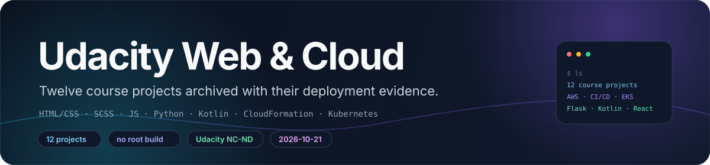
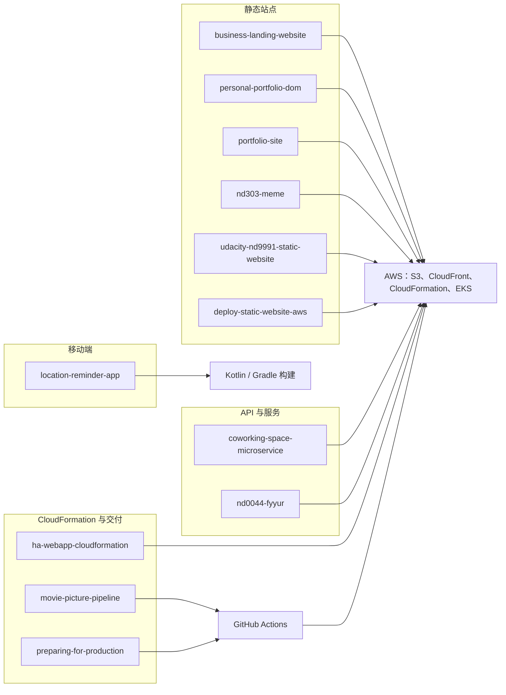

<div align="center">



# Udacity Web & Cloud Projects

**十二个 Udacity 课程项目——静态站点、AWS 部署、CI/CD 流水线、Flask 后端与 Kotlin Android 应用——归档在同一个仓库里。**

S3 + CloudFront · CloudFormation · GitHub Actions → ECR → EKS · Flask + PostgreSQL · Kotlin / Android

**简体中文** · [**English**](README.md)

<a href="nd0044-fyyur/LICENSE.txt"></a>
<a href="docs/projects.md"></a>
<a href="ha-webapp-cloudformation/templates/servers.yml"></a>
<a href="nd0044-fyyur/README.md"></a>
<a href="location-reminder-app/build.gradle"></a>

</div>

> [!NOTE]
> **当前状态。** 十二个 Udacity 课程项目的归档，2026-10-21 从各自独立的仓库合并而来。
> 全部是课程作业：没有发布任何包，仓库根目录没有构建或 CI，也不包含任何部署凭据。

## ✨ 仓库内容

- **十二个独立项目。** 每个顶层目录原本都是一个独立仓库，按原 README 的说明用 `git subtree`
  导入，因此各项目的历史随代码一起保留。
- **每个项目保留自己的 README。** 运行命令、评分点对照与课程要求都写在里面；本文件只做索引。
- **五个 AWS 与 CI/CD 项目。** 两个静态站点部署（S3 + CloudFront）、一个高可用
  CloudFormation 栈，以及两个由 CI 构建并部署的 Kubernetes 服务。
- **三个静态前端站点。** 一个 Sass/BEM 作品集、一个 DOM 与 fetch 练习页，以及一个两页的企业落地页。
- **Flask 出现在三个项目里。** Fyyur（SQLAlchemy + PostgreSQL + Flask-Migrate）、coworking
  分析 API，以及 nd303 的 meme 服务。
- **一个 Kotlin Android 应用。** 位置提醒，使用 Room、Koin、Firebase Auth、Maps 与 geofencing；
  Gradle 8.4.1、Kotlin 1.9.23、`minSdk 24`。
- **一个做了生产化改造的 JavaScript 应用。** Study Night，使用 Parcel、Gulp、ESLint、Mocha 与 Cypress。
- **一个 Python 多媒体流水线。** nd303 的 quote 解析（TXT/DOCX/CSV/PDF）与 Pillow 图片渲染，
  同时提供 CLI 与 Flask 路由。
- **提交证据与代码一起入库。** 控制台截图与 AWS CLI 的 JSON 分别放在各项目的 `screenshots/`
  与 `submission/` 目录。
- **没有根级构建系统。** 顶层没有 `package.json`、`Makefile` 或 workflow；每个项目都在自己的目录里运行。

## 🧠 架构

十二个提交彼此独立，没有共享运行时。下图按各自演示的技术栈分层归组；每个项目都保留自己的 README 与运行说明。



## 🗂️ 项目模块

| 项目 | 课程 / 模块 | 技术栈 | 入口 |
|---|---|---|---|
| [`portfolio-site/`](portfolio-site/README.md) | Portfolio Site 项目 | HTML、SCSS、Sass CLI | `src/index.html`、`npm run build` |
| [`personal-portfolio-dom/`](personal-portfolio-dom/README.md) | Personal Portfolio（DOM + fetch） | HTML、CSS、原生 JS | `index.html`、`js/scripts.js` |
| [`business-landing-website/`](business-landing-website/README.md) | 企业落地页 | HTML、CSS | `index.html`、`contact/contact.html` |
| [`deploy-static-website-aws/`](deploy-static-website-aws/README.md) | Deploy Static Website on AWS | S3、CloudFront、CloudFormation | `scripts/deploy.sh` |
| [`udacity-nd9991-static-website/`](udacity-nd9991-static-website/README.md) | nd9991 Cloud DevOps，Cloud Foundations 项目 | S3、CloudFront、AWS CLI | `deploy.sh` |
| [`ha-webapp-cloudformation/`](ha-webapp-cloudformation/README.md) | 用 CloudFormation 部署高可用 Web 应用 | VPC、ALB、Auto Scaling、EC2、S3、IAM | `scripts/deploy-all.sh` |
| [`location-reminder-app/`](location-reminder-app/README.md) | Android Kotlin Location Reminder | Kotlin、Gradle、Room、Koin、Firebase、Maps | `./gradlew assembleDebug` |
| [`preparing-for-production/`](preparing-for-production/README.md) | Study Night: Preparing for Production | JS、Parcel、Gulp、ESLint、Mocha、Cypress | `npm run gulp` |
| [`coworking-space-microservice/`](coworking-space-microservice/README.md) | cd12355 Coworking Space Service | Flask、PostgreSQL、Docker、CodeBuild、ECR、EKS | `scripts/deploy-codebuild.sh` |
| [`movie-picture-pipeline/`](movie-picture-pipeline/README.md) | React + Flask 应用的 CI/CD | React、Flask、Docker、Actions、ECR、EKS、Terraform | `.github/workflows/` |
| [`nd303-meme/`](nd303-meme/README.md) | nd303 Intermediate Python，Course 3 结课项目 | Python、Pillow、python-docx、pandas、Flask、Xpdf | `src/meme.py`、`src/app.py` |
| [`nd0044-fyyur/`](nd0044-fyyur/README.md) | nd0044 Backend Developer with Python，Course 2 | Flask、SQLAlchemy、PostgreSQL、Flask-Migrate | `app.py`、`flask db upgrade` |

这里没有统一的组件架构可画：它们是十二份互不相关的作业，各自有自己的拓扑。部署类项目在自己的
README 与图里描述架构（例如 [`diagrams/architecture.mmd`](ha-webapp-cloudformation/diagrams/architecture.mmd)
和上面提到的四个 workflow 文件），因此本索引刻意不放架构图。

每个项目的细节——哪些能跑、哪些只是提交内容、证据放在哪里——见
[`docs/projects.md`](docs/projects.md)。

## ☁️ 云与 CI/CD 项目

| 项目 | 创建的资源 | 脚本 | 证据 |
|---|---|---|---|
| `deploy-static-website-aws` | 通过 `infra/cloudformation.yaml` 创建 S3 网站桶、public-read 桶策略与 CloudFront 分配 | `scripts/deploy.sh`、`scripts/sync-site.sh` | `screenshots/`、`submission/evidence/*.json` |
| `udacity-nd9991-static-website` | 通过 AWS CLI 调用创建桶、策略、静态网站托管与 CloudFront | `deploy.sh`、`teardown.sh` | `submission/screenshots/`、`.deploy-state` |
| `ha-webapp-cloudformation` | 跨两个可用区的 VPC、两个公有与两个私有子网、两个 NAT Gateway、ALB、四台 `t3.medium` 的 Auto Scaling 组、私有 S3 桶、IAM instance profile | `scripts/deploy-all.sh`、`scripts/destroy-all.sh` | `submission/evidence/`、`diagrams/` |
| `coworking-space-microservice` | EKS 上的 Flask 分析 API 与 PostgreSQL；CodeBuild 推送 ECR | `scripts/deploy-codebuild.sh`、`scripts/deploy-k8s.sh`、`scripts/seed-db.sh` | `screenshots/`、`submission/evidence/` |
| `movie-picture-pipeline` | EKS 上的 React 与 Flask 服务；四个 GitHub Actions workflow；Terraform 集群 | `setup/terraform/`、`.github/workflows/` | `submission/screenshots/`、运行日志 |

这些项目里打印出来的主机名是在 Udacity 评审期内抓取的，并不会一直存活。三个
CloudFormation/CLI 部署都需要有创建桶、策略、分配与栈权限的 AWS 账号。

## 🚀 快速开始

**要求：** 仓库没有根级入口。每个项目自包含，各自有 README；请在对应项目目录里执行命令。

静态站点，其中只有作品集需要构建：

```sh
cd portfolio-site
npm install
npm run build                      # sass src/scss/main.scss dist/main.css

cd ../business-landing-website
python3 -m http.server 8000        # 或者直接打开 index.html
```

Fyyur（Flask + PostgreSQL），也是唯一带数据库迁移的项目：

```sh
cd nd0044-fyyur
python3 -m venv .venv && . .venv/bin/activate
pip install -r requirements.txt
createdb fyyur                     # 需要本地 PostgreSQL 正在运行
flask db upgrade
python3 app.py                     # http://127.0.0.1:5000
```

nd303 的 meme 生成器（PDF 解析需要 Xpdf 的 `pdftotext` 二进制）：

```sh
cd nd303-meme
python3 -m venv .venv && . .venv/bin/activate
pip install -r requirements.txt
brew install xpdf                  # Debian/Ubuntu 用 apt-get install xpdf
cd src
python3 meme.py --body "Such wow" --author "Xander"
python3 app.py                     # http://127.0.0.1:5000
```

Movie Picture 两个应用，本地运行、不碰 AWS：

```sh
cd movie-picture-pipeline/starter/backend
pipenv install && pipenv run serve  # http://localhost:5000/movies

cd ../frontend
nvm use && npm ci
REACT_APP_MOVIE_API_URL=http://localhost:5000 npm start
```

Android 应用只有在具备 Android SDK、Firebase 项目与 Maps API key 时才能构建：

```sh
cd location-reminder-app
./gradlew testDebugUnitTest         # 与 Android CI workflow 相同的命令
```

> [!TIP]
> 请从项目自己的 README 入手，而不是这个索引：课程要求、评分点对照（课程要求时才有），
> 以及 Firebase、EKS 这类配置都在那里。

## 🧪 测试与 CI

| 位置 | 命令 | 覆盖范围 |
|---|---|---|
| `movie-picture-pipeline/starter/backend` | `pipenv run test` | `test_app.py` 中的 3 个 pytest 测试 |
| `movie-picture-pipeline/starter/frontend` | `CI=true npm test` | 2 个 Jest 套件、3 个测试（`App.test.js`、`MovieList.test.js`） |
| `location-reminder-app` | `./gradlew testDebugUnitTest` | `app/src/test` 中的 2 个单元测试类 |
| `location-reminder-app` | Android Studio 运行器 | `app/src/androidTest` 中的 4 个仪器化测试文件 |
| `nd303-meme` | `python3 -m unittest discover tests` | 一个针对图片流水线的 unittest 文件 |
| `preparing-for-production` | `npm run test`、`npm run cypress:run` | Mocha 单元测试、2 个 Cypress 用例 |
| `movie-picture-pipeline/.github/workflows/` | GitHub Actions | lint 与测试并行，然后 Docker build；CD 推 ECR 并用 `kustomize` 部署 |
| `.github/workflows/android.yml` | GitHub Actions | 在 Java 17 上跑单元测试 |

只有 `movie-picture-pipeline` 和 `location-reminder-app` 带有会构建或测试代码的 GitHub Actions
检查。`nd0044-fyyur` 与 `coworking-space-microservice` 里还有一个 `manual.yml`，但那是 Udacity 的
起始 workflow：它为进来的 PR 创建 Jira 工单，需要 Jira secrets，既不构建也不测试任何东西。

`location-reminder-app/README.md` 要求 JDK 21，而它的 workflow 固定用 Java 17；该 README 的
“Break Down Tests”一节仍是起始模板文字。

## 📁 仓库结构

| 路径 | 内容 |
|---|---|
| `docs/` | banner 资源与逐项目参考 `docs/projects.md` |
| `<project>/` | 每个目录一个自包含课程项目，共十二个 |
| `<project>/README.md` | 课程要求、命令、评分点对照与限制 |
| `<project>/screenshots/`、`<project>/submission/` | 面向评审的截图与 CLI/控制台证据 |
| `<project>/LICENSE*` | 五个项目带有 Udacity 教育许可 |
| `movie-picture-pipeline/.github/workflows/` | 四个 CI/CD workflow 以及 `setup/terraform/` |
| `location-reminder-app/.github/workflows/android.yml` | Android 单元测试 workflow |

## 🧭 范围与限制

这是课程作业归档，不是生产软件。没有发布、版本、SLA 或支持承诺，代码的作用是满足 Udacity 的项目评分点。

- **没有根级许可证。** 仓库根目录既没有 `LICENSE` 也没有 `NOTICE`；五个子项目带有 Udacity 教育许可，
  其余没有。
- **线上基础设施在这里不可复现。** 部署脚本需要 AWS 凭据与权限；EKS 与 Terraform 那条路径还需要
  集群和八个 GitHub secret。
- **证据有时效。** 控制台截图与打印出的端点反映的是提交当时；LoadBalancer 与 CloudFront 主机名
  现在可能已无法解析。
- **应用需要外部凭据。** Android 项目需要 Firebase 配置与 Maps API key，这些不在可用的检出里。
- **清单里有演示用凭据。** coworking 的 Kubernetes Secret 以明文包含占位数据库密码，复用前必须替换。
- **本次改版未做验证。** 没有执行任何构建、测试、部署或真机运行；浅克隆也不包含各项目的 subtree
  历史，因此该说法来自原 README。

> [!WARNING]
> 部署脚本会创建计费 AWS 资源。用完请销毁栈（`./scripts/destroy-all.sh`、`./teardown.sh`），
> 并且不要把真实凭据提交进仓库；CI workflow 读取的是 secrets，不是入库的密钥。

## 🤝 参与贡献

欢迎针对文档与参考信息的 Issue 与 PR：

1. 以各项目 README 为准；改动这里的命令时同步更新对应 README；
2. 不要加入凭据、账号标识、私有 URL 或构建产物；
3. 复用某个项目时，保留它的 `LICENSE` 文件与 Udacity 署名。

如果这个归档对你有参考价值，欢迎点个 ⭐。

## 📄 许可证与署名

仓库根目录没有许可证文件，因此不对整个归档声明许可证。许可按项目区分：

- **Udacity 教育许可** —— `coworking-space-microservice/LICENSE.txt`、`movie-picture-pipeline/LICENSE.md`、
  `nd0044-fyyur/LICENSE.txt`、`personal-portfolio-dom/LICENSE.txt` 与
  `preparing-for-production/LICENSE.txt` 采用 Udacity 文本（Copyright © 2012–2020, Udacity, Inc.），
  按 Creative Commons Attribution-NonCommercial-NoDerivs 4.0 授予教育内容使用权，并把付费培训、
  转售与院校授课列为商业用途。
- **元数据中的另一种声明** —— `preparing-for-production/package.json` 为该包声明了 `MIT`，而同目录
  又附带 Udacity 的许可证文本。
- **没有许可证文件** —— `portfolio-site`、`business-landing-website`、`deploy-static-website-aws`、
  `ha-webapp-cloudformation`、`location-reminder-app`、`nd303-meme` 与
  `udacity-nd9991-static-website` 都没有许可证文件。`nd303-meme/README.md` 记录其起始代码来自
  `udacity/PYND`，适用原 Udacity Nanodegree 许可。
- **第三方资源** —— Bootstrap 4.3.1（MIT）与 Font Awesome Free 5.8.1（CC BY 4.0、OFL 1.1、MIT）
  以 vendor 形式放在 `deploy-static-website-aws/vendor/` 与
  `udacity-nd9991-static-website/website/vendor/` 下，许可证文本保留在对应目录中。

Udacity、Nanodegree 与各课程名称是 Udacity 的商标。本仓库是学生作业归档，与 Udacity 无隶属关系，
也未获其背书。

## ⭐ Star 历史

<div align="center">

<a href="https://star-history.com/#LeoLin990405/udacity-web-cloud-projects&Date">
  
</a>

</div>
